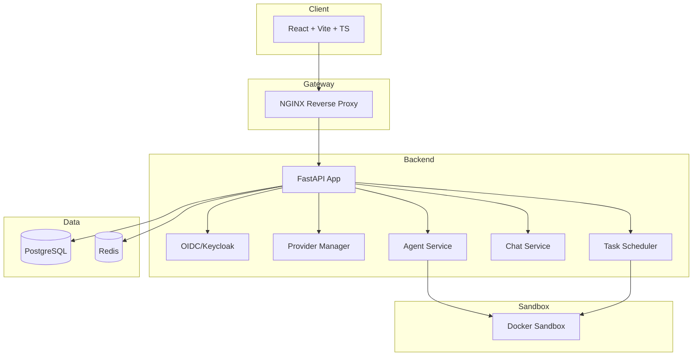

# Beacon Hub

> Work in progress. This checkpoint may be incomplete or fail tests. See PLAN.md and STATUS.md before use.


**Ryan Vo | AI & Machine Learning**

Open-source Grok Bot alternative. Choose your own model and sandbox.

## Overview

Beacon Hub is a self-hosted AI agent platform that lets you connect your own LLM providers, register multiple models per provider, create agents with specific models, and run them in sandboxed environments. Built for developers who want full control over their AI workflows without vendor lock-in.

### Problem

Existing AI agent platforms either lock you into a single provider, don't support multiple models per connection, or require complex infrastructure. Beacon Hub solves this by providing a clean, self-hosted platform where you:

- **Bring your own models**: Connect any OpenAI-compatible, Anthropic, Gemini, or Ollama provider once, then register multiple models under that connection
- **Choose per agent/task**: Each agent selects its model; tasks and routines can override the agent's default
- **Run in sandboxes**: Execute code and tools in isolated Docker containers
- **Own your data**: PostgreSQL persistence, OIDC/Keycloak authentication, full audit logging

### AI/ML Approach

Beacon Hub implements a **provider-agnostic model routing layer** that normalizes requests across OpenAI-compatible, Anthropic Messages, and Gemini GenerateContent APIs. The core domain engine handles:

- **Multi-model provider management**: One connection → many models with independent capabilities (chat, embedding, image/video generation)
- **Agent configuration**: Model selection, system prompts, tool schemas, sandbox policies
- **Conversation persistence**: Full message history with streaming support
- **Task scheduling**: Cron-like routines with model override capability

The deterministic offline core works without any LLM key. LLM explanations are opt-in, labeled advisory, grounded in actual records, with clear provider errors.

## Features

- **Provider & Model Management**: Configure credentials once, register unlimited models per provider, support for chat/embedding/image/video model types
- **Agent Workflows**: Create agents with selected models, persistent conversations, streaming chat UI
- **Sandboxed Execution**: Docker-based code execution with configurable policies (planned)
- **Authentication**: OIDC authorization code flow with PKCE via Keycloak, HttpOnly cookies, CSRF protection, SAML broker support
- **Audit Logging**: Security-relevant events tracked with user context

## Quick Start

### Prerequisites

- Docker and Docker Compose
- Node.js 24 (for local frontend development)
- Python 3.12 (for local backend development)

### Development

```bash
# Backend
cd backend
python -m venv .venv
source .venv/bin/activate
pip install -r requirements.txt
cp ../.env.example .env  # Edit with your values
python -m pytest tests/
uvicorn app.main:app --reload --host 127.0.0.1 --port 8000

# Frontend (separate terminal)
cd frontend
npm install
npm run dev
```

### Docker Compose (Production-like)

```bash
cp .env.example .env
# Edit .env with secure passwords
docker-compose up --build
```

Access:
- Frontend: http://localhost:3000
- Backend API: http://localhost:8000
- API Docs: http://localhost:8000/docs
- Keycloak: http://localhost:8080 (admin/admin)

## Architecture



## API Reference

### Health
- `GET /health` - Full health check
- `GET /health/ready` - Readiness probe
- `GET /health/live` - Liveness probe

### Authentication
- `GET /auth/login` - Get OIDC authorization URL
- `POST /auth/callback` - Exchange code for tokens
- `POST /auth/refresh` - Refresh access token
- `POST /auth/logout` - Clear cookies, optional Keycloak logout
- `GET /auth/me` - Get current user

### Providers
- `POST /providers` - Create provider
- `GET /providers` - List providers (paginated)
- `GET /providers/{id}` - Get provider
- `PATCH /providers/{id}` - Update provider
- `DELETE /providers/{id}` - Delete provider

### Models
- `POST /providers/{provider_id}/models` - Register model
- `GET /providers/{provider_id}/models` - List models (paginated)
- `GET /providers/{provider_id}/models/{model_id}` - Get model
- `PATCH /providers/{provider_id}/models/{model_id}` - Update model
- `DELETE /providers/{provider_id}/models/{model_id}` - Delete model

### Agents (planned)
- `POST /agents` - Create agent
- `GET /agents` - List agents
- `GET /agents/{id}` - Get agent
- `PATCH /agents/{id}` - Update agent
- `DELETE /agents/{id}` - Delete agent

### Conversations (planned)
- `POST /conversations` - Create conversation
- `GET /conversations` - List conversations
- `GET /conversations/{id}` - Get conversation with messages
- `POST /conversations/{id}/messages` - Send message (streaming)
- `DELETE /conversations/{id}` - Delete conversation

### Tasks (planned)
- `POST /tasks` - Create task
- `GET /tasks` - List tasks
- `GET /tasks/{id}` - Get task with runs
- `POST /tasks/{id}/run` - Execute task
- `GET /tasks/{id}/runs` - List task runs

## Configuration

### Environment Variables

| Variable | Description | Default |
|----------|-------------|---------|
| `DATABASE_URL` | PostgreSQL async URL | `sqlite+aiosqlite:///./beacon_hub.db` |
| `SECRET_KEY` | JWT signing key (min 32 chars) | Required |
| `ENVIRONMENT` | `development` or `production` | `development` |
| `OIDC_ENABLED` | Enable OIDC authentication | `true` |
| `OIDC_ISSUER_URL` | Keycloak realm URL | `http://localhost:8080/realms/beacon-hub` |
| `OIDC_CLIENT_ID` | Keycloak client ID | `beacon-hub` |
| `OIDC_CLIENT_SECRET` | Keycloak client secret | Required |
| `OIDC_REDIRECT_URI` | OAuth redirect URI | `http://localhost:3000/callback` |
| `LLM_API_KEY` | Default LLM API key | None |
| `LLM_PROVIDER` | Default provider type | `openai-compatible` |
| `LLM_MODEL` | Default model ID | `gpt-4o-mini` |
| `LLM_BASE_URL` | Default provider base URL | None |

### LLM Provider Configuration

| Provider | Base URL Example | Notes |
|----------|------------------|-------|
| OpenAI | `https://api.openai.com/v1` | Native OpenAI |
| OpenAI-Compatible | `https://api.example.com/v1` | LiteLLM, OpenRouter, Ollama, etc. |
| Anthropic | `https://api.anthropic.com` | Messages API |
| Gemini | `https://generativelanguage.googleapis.com` | GenerateContent API |
| Ollama | `http://localhost:11434/v1` | Local models |

## SSO / SAML Setup

Keycloak supports upstream SAML IdPs through identity brokering:

1. In Keycloak Admin Console → Identity Providers → Add SAML v2.0
2. Configure IdP metadata/entity ID/SSO URL
3. Map SAML attributes to Keycloak user attributes
4. Enable "First Login Flow" for user provisioning
5. Users can then sign in via SAML IdP → Keycloak → Beacon Hub

## Security Limitations

- Development mode uses SQLite; production requires PostgreSQL
- Default SECRET_KEY is insecure; must be overridden in production
- OIDC client secret must be configured in Keycloak and .env
- Sandbox Docker execution requires host Docker socket (consider rootless)
- No rate limiting on API endpoints (planned)
- CORS origins must be explicitly configured for production

## Development

### Running Tests

```bash
# Backend tests
cd backend
source .venv/bin/activate
pytest tests/ -v

# Frontend tests
cd frontend
npm test
```

### Code Style

- Backend: Black, isort, mypy (configured in pyproject.toml)
- Frontend: ESLint, TypeScript strict mode

## Deployment

### TLS Reverse Proxy Requirements

- Terminate TLS at reverse proxy (nginx/Traefik/Caddy)
- Forward `X-Forwarded-Proto`, `X-Forwarded-For`, `Host` headers
- Configure Keycloak `KC_HOSTNAME` and `KC_PROXY=edge`
- Set `OIDC_REDIRECT_URI` to HTTPS frontend URL

### Backup/Restore

```bash
# Backup PostgreSQL
docker exec beacon-hub-postgres pg_dump -U beacon_hub beacon_hub > backup.sql

# Restore
docker exec -i beacon-hub-postgres psql -U beacon_hub beacon_hub < backup.sql
```

### IdP Enrollment

1. Deploy Keycloak with persistent volume
2. Import realm configuration (provided in `docs/keycloak-realm.json`)
3. Create client `beacon-hub` with redirect URIs
4. Configure SAML/OIDC identity providers as needed
5. Set client secret in `.env`

## License

MIT License - Copyright (c) 2026 Ryan Vo <ryandtvo@gmail.com>

## Changelog

See [CHANGELOG.md](CHANGELOG.md) for release history.